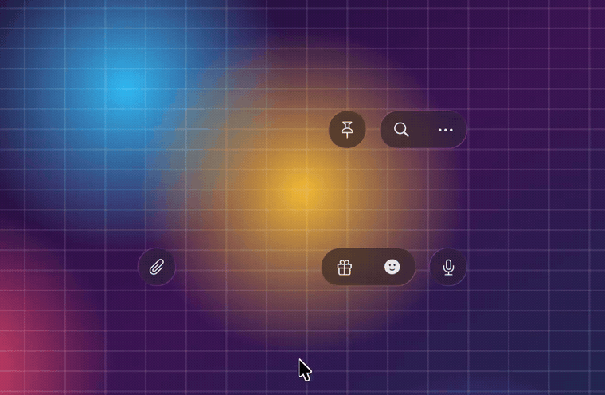
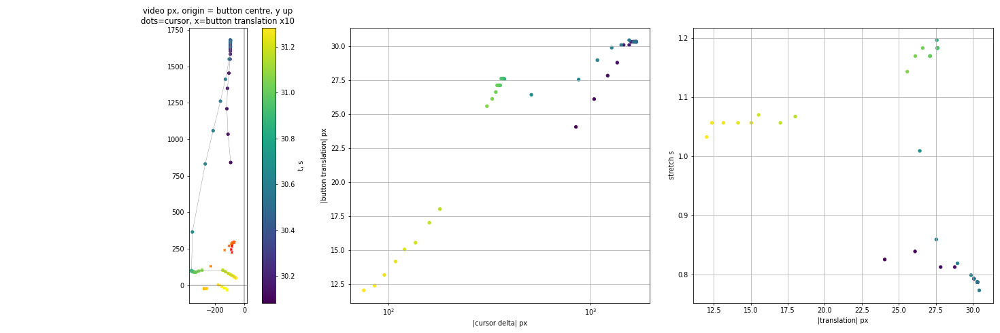

<div align="center">

# JellyGlass

**Liquid Glass that stretches like jelly under your cursor.**

AppKit buttons for macOS 26 that swell when pressed, follow your drag, stretch along the pull,\
and wobble back — plus a dependency-free web version you can try in a browser.

[](https://54degree5.github.io/JellyGlass/)   

<a href="docs/media/showreel.mp4"></a>

<a href="https://github.com/54degree5/JellyGlass/stargazers"></a> <a href="https://github.com/54degree5/JellyGlass/forks"></a> <a href="https://github.com/54degree5/JellyGlass/commits/main"></a> <a href="https://github.com/54degree5/JellyGlass/issues"></a>

**If this made you smile, a ⭐ helps others find it.**

</div>

---

## Why

macOS 26's `NSGlassEffectView` gives you the Liquid Glass *material*. It does not give you the *feel* — the
way glass in a polished app gives under your finger. JellyGlass adds that feel, and writes down what it took
to get it working inside AppKit's glass containers (it is less obvious than it sounds — see
[How it works](#how-it-works)).

- **Press**: the glass swells 7 % and lightens.
- **Drag**: it follows the cursor with a small, rubber-banded travel and stretches along the axis of the pull
  (area preserved). Pull diagonally and it simply grows. Never rotates.
- **No ceiling**: stretch and travel grow with a logarithm of the cursor distance, so the further you pull the
  less each extra point adds, and it never hits a hard stop.
- **Release**: the glass wobbles back on a jelly spring while the icon bounces on its own, springier one.
- **On top or merge**: the pressed button is lifted over its neighbours (default), or melts into them through
  the container's glass group.

The numbers are not guessed: they were measured, frame by frame, from a screen recording of a production app
([MEASUREMENTS.md](docs/MEASUREMENTS.md)).

## Try it

**In the browser** (any modern browser, no install): <https://54degree5.github.io/JellyGlass/>

**Download the demo app** (macOS 26+, Apple silicon and Intel): [latest release](https://github.com/54degree5/JellyGlass/releases/latest).
It is ad-hoc signed, not notarized: unzip, then right-click → Open (or `xattr -dr com.apple.quarantine JellyGlassDemo.app`).

**Or build it** (macOS 26+, Xcode 26 / Swift 6.2+):

```bash
git clone https://github.com/54degree5/JellyGlass.git
cd JellyGlass
swift run -c release JellyGlassDemo
```

Drag any button. Keys: `K` on top ⇄ merge · `S` spring (jelly / wobble / snappy) · `A` stretch
(standard / wide / heavy) · `C` glass style.

## Use it in your app

```swift
// Package.swift
.package(url: "https://github.com/54degree5/JellyGlass.git", branch: "main")
```

```swift
import JellyGlass

let mic = JellyGlassButton(size: CGSize(width: 44, height: 44), symbols: ["mic"])
mic.spring = .jelly            // .jelly (default) · .wobble · .snappy
mic.stretch = .standard        // .standard · .wide · .heavy
mic.liftsOnPress = true        // false: melt into neighbours instead

// Optional: group buttons so neighbours share one glass surface and merge when `liftsOnPress` is false.
let group = NSGlassEffectContainerView()
group.spacing = 14
let holder = NSView(frame: group.bounds)
holder.addSubview(mic)
group.contentView = holder
```

Any view works as content: `JellyGlassButton(size:contentView:)`. The button deforms its glass *and* its content.

## The model

With `d` the cursor's distance in points from where the button was pressed:

| | formula | at d = 38 / 80 / 185 / 800 pt |
|---|---|---|
| body travel `t(d)` | `6.5 · ln(1 + d / 28)` | 5.6 / 8.8 / 13.2 / 22 pt |
| stretch `e(d)` | `0.105 · ln(1 + d / 50) · d² / (d² + 40²)` | 0.03 / 0.08 / 0.16 / 0.30 |

Beyond ~200 pt the recorded body travel plateaus (it contains a single long flick), but by hand the app keeps stretching,
so the model deliberately keeps growing — slowly, without a ceiling (see the shaded area below).

**Any size.** The numbers above come from a 44 pt circle. For other sizes the *absolute* change follows them, not the
ratio: along the pull the factor is `1 + e·√(44/L)`, across it `1 − (1 − 1/(1+e))·(44/L)`, where `L` is the button's length
on that axis. A 44 pt circle behaves exactly as measured; a 108 pt pill pulled down keeps its width (−2 pt instead of
−10 pt); a 360 pt bar pulled sideways grows by ~9 % instead of ~30 %. Press swell scales the same way. (The AppKit glass
margin grows with the width too, so long buttons are never clipped.)

Pulled along an axis the shape scales `×(1+e)` along it and `÷(1+e)` across it. Pulled diagonally the
axial part fades out and the whole button grows `1 + 0.6·e` instead. Springs (stiffness / damping):

| preset | held | after release |
|---|---|---|
| `jelly` | 1500 / 70 | 420 / 12 — swings past rest once or twice |
| `wobble` | 1500 / 70 | 240 / 6 |
| `snappy` | 3600 / 120 | 3600 / 120 — back in ~60 ms |



## How it works

The short version of what is not in any documentation:

1. A glass container renders **all** its children through one SDF canvas that is sized to the *undeformed*
   buttons and reset on every layout. Transform the glass layers and the blur is clipped to the old box.
2. So the `NSGlassEffectView` is made **larger than the button** (a 90 pt margin) and its silhouette is set with
   the private `_setPath:` — the resting capsule, scaled and shifted every frame — and the container is asked
   to re-layout each frame so it re-reads the path. The icons live in the content view with their own spring.
3. The private `_interactionState = 1` lifts a glass out of its group and draws it on top of its neighbours
   (a highlight, no merging). That is the default "on top" behaviour; leave it off and the button melts
   into neighbours instead.
4. Merging has physics: the bridge between two glasses appears when the gap is below `spacing / 2`, but they
   start leaning toward each other already below `spacing`. Resting gap ≥ `spacing` avoids pointed tips at rest.

Full write-up with the layer tree and the dead ends: [docs/HOW_IT_WORKS.md](docs/HOW_IT_WORKS.md).

## Web version

[`docs/index.html`](docs/index.html) is a single file, no dependencies. Open it and, after a moment, a cursor starts
pressing the buttons and wandering with them (press anything to take over; **▶ demo** brings it back).

The glass is real, not a CSS imitation: a WebGL2 fragment shader draws the scene behind the buttons and draws it again
*through* each button's capsule — the sample point is bent by the slope of a rounded glass edge (refraction), split per
colour channel (dispersion), slightly magnified in the middle, lightly blurred, then lit with a fresnel rim and a faint
specular glint. Each capsule follows its button's jelly motion every frame, so the refraction stretches and wobbles with
it (120 fps on a retina MacBook). The physics is the same as the AppKit version: same formulas, same springs.

Two honest limits: the glass refracts **its own scene** (a shader cannot see the DOM, so it works because the background
is drawn by the same shader), and without WebGL2 the page falls back to a frosted CSS glass. Making it refract arbitrary
page content needs a page capture or Chromium's SVG `backdrop-filter`; contributions welcome.

## Caveats

- **Private API.** `_setPath:` and `_interactionState` are private AppKit selectors, resolved at runtime
  (they exist on macOS 26). Fine for tools and experiments, not for the App Store. If a selector goes missing
  the call is skipped and the button degrades to icon animation only.
- **macOS 26+** (Tahoe). Earlier systems have no `NSGlassEffectView`.
- The model was measured from one recording of one button. It matches that recording closely; other buttons
  and larger pulls are extrapolation.
- Not affiliated with Telegram or Apple. The interaction was observed in Telegram for macOS; no Telegram code
  or assets are used. See also [liquid-glass-react](https://www.npmjs.com/package/liquid-glass-react) for the web.

## Roadmap

- [ ] Refraction of arbitrary page content on the web
- [ ] Gooey merge for the web demo
- [ ] SwiftUI wrapper (`JellyGlass { … }`)
- [ ] Haptics and sound hooks
- [ ] Per-button response presets for large controls

## Contributing

Issues and PRs welcome — especially measurements from other apps (record the screen, drop the file in an
issue), and anything that makes the AppKit side less private-API-dependent.

## Star history

<a href="https://star-history.com/#54degree5/JellyGlass&Date">
  <picture>
    <source media="(prefers-color-scheme: dark)" srcset="https://api.star-history.com/svg?repos=54degree5/JellyGlass&type=Date&theme=dark">
    <source media="(prefers-color-scheme: light)" srcset="https://api.star-history.com/svg?repos=54degree5/JellyGlass&type=Date">
    
  </picture>
</a>

## License

MIT — see [LICENSE](LICENSE).
